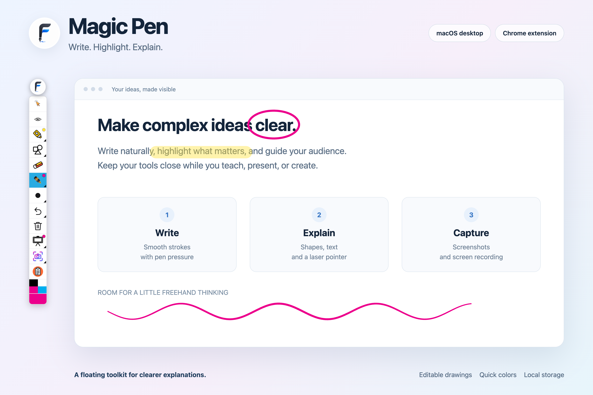

# Magic Pen

Draw, highlight, explain, capture, and record with a floating annotation toolbar.
Magic Pen includes a **native macOS desktop app** and a **Chrome extension** in one repository.

The desktop app draws over your Mac workspace. The Chrome extension draws over webpages and keeps saved annotations associated with each page.

**Download:** [Latest GitHub release](https://github.com/bashkid/magic-pen/releases/latest), with separate ZIP downloads for Chrome and macOS.



*Product preview uses the Chrome extension’s actual toolbar and stroke renderer. The macOS version uses native AppKit controls.*

## Contents

- [Features](#features)
- [Install the Chrome extension](#install-the-chrome-extension)
- [Build and run the macOS app](#build-and-run-the-macos-app)
- [Using the toolbar](#using-the-toolbar)
- [Drawing and handwriting](#drawing-and-handwriting)
- [Saving and output files](#saving-and-output-files)
- [Screenshots and recording](#screenshots-and-recording)
- [Keyboard shortcuts](#keyboard-shortcuts)
- [Troubleshooting](#troubleshooting)
- [Permissions and local storage](#permissions-and-local-storage)
- [Project structure and development](#project-structure-and-development)

## Features

| Feature | macOS desktop app | Chrome extension |
|---|---|---|
| Drawing surface | Transparent overlays across connected displays’ usable workspaces | Current webpage, with annotations anchored to page coordinates while scrolling |
| Freehand pen | Smooth curves and rounded ends | Native Canvas Bézier curves and coalesced movement samples |
| Pressure sensitivity | Uses pressure reported by supported macOS input devices | Uses pressure reported by pen PointerEvents |
| Highlighter | Adjustable color, weight, and opacity | Adjustable color, weight, and opacity |
| Shapes | Line, rectangle, ellipse | Line, rectangle, ellipse |
| Text | Native text entry on the overlay | Inline text entry on the page |
| Laser pointer | Temporary fading trail while drawing | Temporary fading trail that follows pointer movement |
| Eraser | Removes touched strokes | Removes touched strokes |
| History | Undo, redo, and clear | Undo, redo, and clear |
| Visibility | Hide annotations or switch to click-through pointer mode | Hide annotations or switch to click-through pointer mode |
| Colors | Quick swatches, palette, and system color picker | Quick swatches and a larger palette |
| Screenshots | Region, full screen, or clipboard | Region, visible webpage, or clipboard |
| Recording | Main display; toolbar and auxiliary app windows excluded | User-selected screen, window, or tab |
| Saved annotations | One local session file | Separate saved drawings for each origin and page path |
| Screen shade | — | White background behind annotations |
| Countdown timer | Movable on-screen timer | — |
| Toolbar | Movable and collapsible; native popovers | Movable and collapsible; flyouts adapt near screen edges |

No account, application server, or subscription is required.

## Install the Chrome extension

For a packaged download, open the [latest release](https://github.com/bashkid/magic-pen/releases/latest), download the **Chrome extension ZIP**, and extract it. Follow the **Load unpacked** steps below using that extracted folder.

### Load from this repository

1. Clone the repository, or choose **Code → Download ZIP** on GitHub and extract it.

   ```bash
   git clone https://github.com/bashkid/magic-pen.git
   ```

2. In Chrome, open `chrome://extensions`.
3. Enable **Developer mode**.
4. Click **Load unpacked** and select the repository’s root folder: the folder containing `manifest.json` and `src/`.
5. Open or refresh a regular website, then click **Magic Pen** in Chrome’s extensions menu.
6. Pin Magic Pen to the Chrome toolbar for easier access.

A standalone extension ZIP works the same way: extract it first, then select the extracted folder containing `manifest.json`. Chrome’s **Load unpacked** button accepts a directory.

### Update an existing installation

Update the files in the folder Chrome originally loaded, click **Reload** on the Magic Pen card at `chrome://extensions`, and **refresh the webpage**. Both steps are required after a content-script update.

If Chrome is loading a separate copied folder, updating your Git checkout alone will not update that copy.

### Supported pages

Use Magic Pen on regular websites. Chrome blocks content-script injection on internal pages such as `chrome://extensions`, New Tab, and Chrome Web Store pages. On an unsupported page, Magic Pen shows an **!** badge; hover over the icon for guidance.

Local `file://` pages also require Chrome’s **Allow access to file URLs** setting in the extension’s details.

## Build and run the macOS app

To use a prebuilt app, download the **Mac ZIP** from the [latest release](https://github.com/bashkid/magic-pen/releases/latest), extract it, and move `MagicPen.app` to Applications. Version 0.2.1 supports Apple silicon and Intel Macs running macOS 14 or later. The app is locally signed and is not notarized; macOS may require approval in Privacy & Security before first launch.

### Requirements

- macOS **14 or later**.
- An installed Swift toolchain compatible with the package’s **Swift tools 5.9** manifest; Xcode provides the build and signing tools.
- Optional: **FFmpeg** for converting finished recordings to WebM. Without it, the app keeps a playable MOV recording.

From the repository root:

```bash
./mac-app/build_app.sh
open mac-app/MagicPen.app
```

The script builds the release executable, packages its icons and resource bundle, and applies a local ad hoc code signature.

Magic Pen runs in the **menu bar**, without a Dock icon. Click the pen icon to show or hide the overlay and toolbar. Right-click it for **Toggle Overlay** and **Quit Magic Pen**.

For additional setup, capture details, and desktop troubleshooting, see the [macOS guide](mac-app/README.md).

## Using the toolbar

Drag the round pen logo to move the toolbar. Click the logo to collapse or expand it.

| Control | What it does |
|---|---|
| Pointer | Pass clicks through to the underlying app or webpage |
| Eye | Show or hide annotations without clearing the drawing |
| Highlighter | Select a translucent freehand marker |
| Shapes | Choose Line, Rectangle, Ellipse, Text, or Laser |
| Eraser | Remove strokes near the pointer |
| Pen | Select the freehand pen |
| Size | Adjust the active paint tool’s weight and opacity |
| Undo | Undo the last committed mark |
| Clear | Remove all marks and reset undo/redo history |
| Board | Start/stop recording and save/restore drawings; the extension also offers screen shade |
| Timer | Desktop only: configure or stop a visible countdown |
| Camera | Choose a screenshot region, full capture, or clipboard action |
| Clipboard | Copy a screenshot to the clipboard |

The Chrome toolbar uses small corner triangles for additional actions. For example, the Pen corner opens colors, weight, and opacity; the Undo corner opens Undo and Redo. In the desktop app, selecting Pen or Highlighter opens a native settings popover.

Weight controls range from **1–40**, and opacity controls from **5–100%**. Use the quick color swatches or the larger color selection control to change color.

## Drawing and handwriting

Select **Pen** or **Highlighter**, then press and drag to draw. Both versions preserve pressure alongside sampled points when the input device reports it. Mouse strokes retain the selected width.

The Chrome renderer sends continuous cubic curves to Canvas instead of joining a coarse polygon outline. It retains the intermediate movement samples returned by `getCoalescedEvents()` when available, with a normal pointer-event fallback. Variable-pressure strokes use curved outlines with rounded caps.

Choose **Ellipse** for a geometric circle or oval. Freehand drawing remains freehand; it does not automatically snap handwriting into geometric shapes.

The eraser currently removes an entire stroke when it touches a nearby sampled point. It is not a pixel eraser or a stroke-splitting tool.

For text in Chrome, select **Text**, click the page, type, and press **Enter** or click elsewhere to commit. **Escape** cancels text entry. The Mac version uses a native text field and commits when editing ends.

## Saving and output files

Use the **Board** panel’s Save and Restore actions to retain editable drawings. A screenshot exports pixels; it does not replace saving an editable session.

| Data or output | Desktop app | Chrome extension |
|---|---|---|
| Editable drawings | `~/Library/Application Support/MagicPen/session.json` | `chrome.storage.local`, keyed by the page’s origin and pathname |
| Screenshots | `~/Pictures/MagicPen/` as PNG | Save As dialog; suggested `annotator/screenshot-….png` name |
| Recordings | `~/Movies/MagicPen/` as WebM when FFmpeg is available, otherwise MOV | Save As dialog; suggested `annotator/recording-….webm` name |
| Tool settings | Current application session | Stored in `chrome.storage.local` |
| Clipboard captures | System clipboard | Browser clipboard API |

The Chrome extension restores saved annotations when its overlay is activated and the current drawing is empty. Use **Save** explicitly before reloading a page if you want to retain new work. URL query strings and fragments are not part of its storage key.

The desktop app keeps one saved session rather than one session per application. Restore it through the Board panel after launching. Session files from before pressure support still load.

## Screenshots and recording

### Chrome

- Click **Camera**, then drag a region; a click without a substantial drag captures the visible page. The Camera flyout also offers a full visible-page capture.
- Use **Clipboard** to copy a PNG image.
- The main toolbar hides while the screenshot is captured. Visible annotations remain in the capture.
- Open **Board → Record**, select a screen/window/tab, and start sharing. Click the recording control again to finish.
- Chrome’s recording implementation captures **video only**, using WebM with a supported VP9/VP8 codec.

“Whole page” in the screenshot controls means the **visible viewport**. The extension does not stitch a scrolling screenshot of an entire document.

### macOS

- Camera offers the system region selector, full-screen capture, and clipboard capture.
- Board recording captures the **main display** at a target of **30 fps**, including the cursor and annotation overlays.
- The app excludes its toolbar and auxiliary app windows from recordings.
- A temporary MOV is converted to WebM after recording stops when FFmpeg is found. If conversion is unavailable or fails, the app retains the MOV instead.
- The current native recorder captures **video only**.

macOS may request Screen Recording permission. Grant it in **System Settings → Privacy & Security → Screen Recording**; the label may include system audio on some macOS versions. Relaunch Magic Pen if macOS requests it.

## Keyboard shortcuts

### Chrome extension

| Shortcut | Action |
|---|---|
| `Esc` | Close an open flyout; otherwise hide the overlay |
| `Cmd/Ctrl+Z` | Undo |
| `Cmd/Ctrl+Shift+Z` | Redo |

These shortcuts apply while the extension overlay is active on the current page.

### macOS desktop app

| Shortcut | Action |
|---|---|
| `Cmd+1` | Pointer |
| `Cmd+2` | Pen |
| `Cmd+3` | Highlighter |
| `Cmd+4` | Eraser |
| `Cmd+5` | Line |
| `Cmd+6` | Rectangle |
| `Cmd+7` | Ellipse |
| `Cmd+8` | Text |
| `Cmd+9` | Laser |
| `Cmd+Z` / `Cmd+Shift+Z` | Undo / redo |
| `Cmd+Delete` | Clear annotations and history |
| `Cmd+C` | Copy a full-screen screenshot |
| `Cmd+S` | Save a full-screen screenshot |
| `Cmd+T` | Collapse or expand the toolbar |
| `Cmd+Q` | Quit Magic Pen |

Desktop shortcuts are handled when Magic Pen receives keyboard events. Drawing shortcuts require the overlay to be active; they are not system-wide hotkeys. **Cmd+S takes a screenshot**; save editable annotations through the Board panel.

## Troubleshooting

| Symptom | What to check |
|---|---|
| `Cannot access a chrome:// URL` | Open a regular website before clicking Magic Pen. Reload the updated extension and clear old error entries if Chrome still displays a previous log. |
| Extension toolbar does not appear | Confirm the extension is enabled and has site access. Refresh the webpage after reloading the extension. |
| Circles still look polygonal after updating | Confirm version **0.2.1** is loaded, reload the extension, and refresh the website so it uses the new renderer. |
| Duplicate Magic Pen toolbars | Check for multiple loaded copies of the extension and disable the extra copy. |
| Pen pressure has no effect | The device, driver, OS, and browser must report pressure. A normal mouse keeps constant width. |
| Chrome screenshot copying fails | Check the toolbar status message and the page’s clipboard restrictions. Saving a PNG is a separate capture option. |
| Recording does not start | Check capture permissions, the selected source, and the toolbar’s status message or native app logs. |
| Mac app opens without a normal window | This is a menu-bar app. Click its pen icon near the clock. |
| Mac app cannot find its icon bundle | Build with `build_app.sh`; the script places SwiftPM resources inside the app’s resource directory. |
| Mac recording is MOV rather than WebM | FFmpeg was not found in the supported locations, or conversion failed. The MOV preserves the recording. |

For Chrome diagnostics, open the Magic Pen card at `chrome://extensions` and inspect its **service worker**. The offscreen document is the recording component. Native recording failures are logged by the app.

## Permissions and local storage

The extension requests page access so it can add its canvas and toolbar. Its other permissions support screen selection, offscreen recording, downloads, local settings and drawings, script injection, and clipboard export.

The native app uses macOS capture permissions for screenshots and recording. FFmpeg, when used, runs locally.

Drawings, settings, and capture outputs are stored locally. The project does not require a backend or provide cloud synchronization.

## Project structure and development

```text
magic-pen/
├── manifest.json                 # Chrome extension entry points and permissions
├── src/
│   ├── content.js                # Toolbar, drawing events, page captures, persistence
│   ├── stroke-renderer.js        # Bézier geometry and pressure samples
│   ├── content.css               # Page overlay styles
│   ├── background.js             # Action button, capture and download coordination
│   ├── offscreen.html / .js      # MediaRecorder document
│   └── icons/                    # Toolbar artwork
├── mac-app/
│   ├── Package.swift            # Native Swift package
│   ├── Sources/MagicPen/        # AppKit UI, drawing state, storage and capture
│   ├── Resources/               # App metadata and icon
│   └── build_app.sh             # Release app packaging and signing
├── tests/                       # Node.js extension regression tests
└── docs/images/                 # Product preview
```

The extension has no dependency installation or bundling step. Its manifest loads the renderer before the content script; the click-to-inject fallback uses the same order.

Run extension regression tests with a Node.js installation that supports `node:test`:

```bash
node --test tests/*.test.cjs
```

The tests cover restricted-page handling, fallback injection, sparse-circle geometry, variable pressure, stationary strokes, coalesced events, and renderer load order.

For native development:

```bash
cd mac-app
swift build
./build_app.sh
open MagicPen.app
```

Native build products, generated app bundles, and local graph-analysis files are excluded from Git. Rebuild the app bundle after changing native source. Refresh both the extension and the webpage after changing Chrome content scripts.

To package a universal Mac release with both supported architectures:

```bash
./mac-app/build_app.sh --arch arm64 --arch x86_64
```
